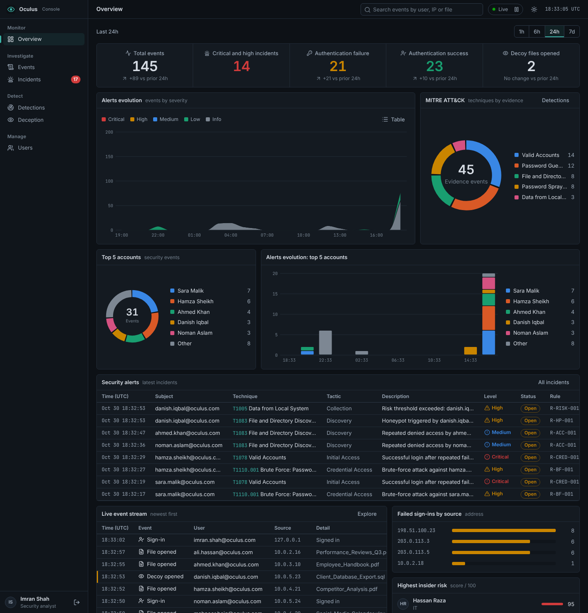
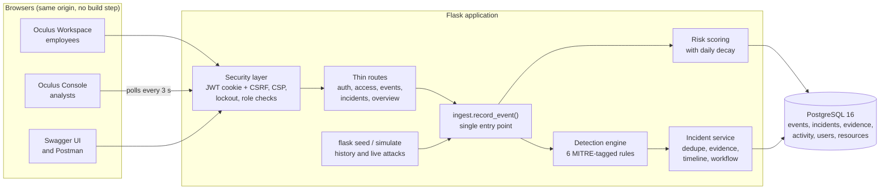
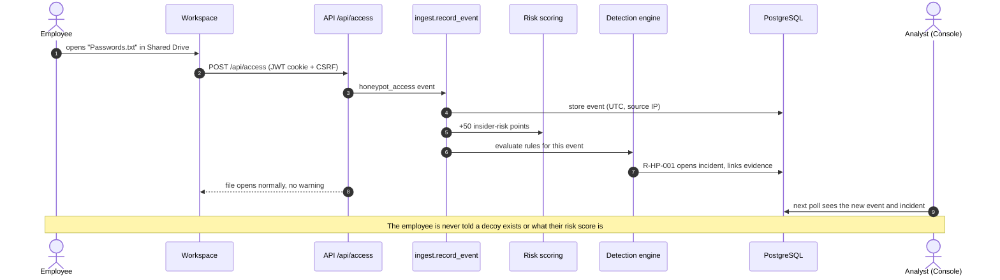
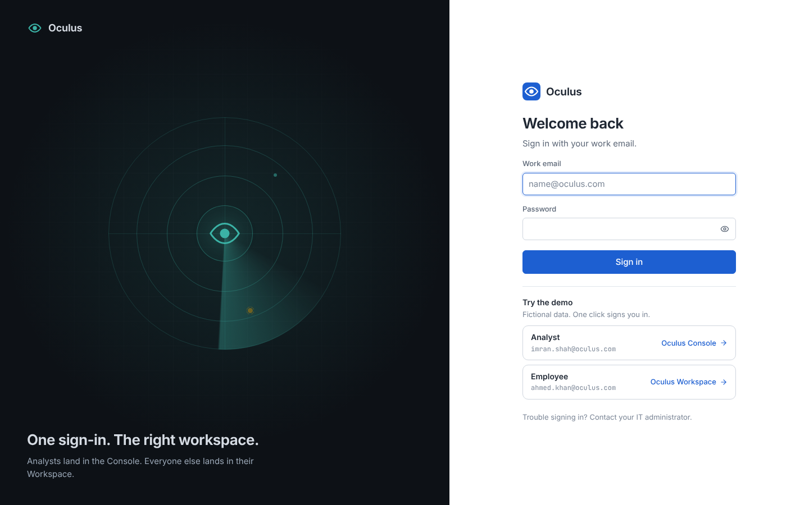
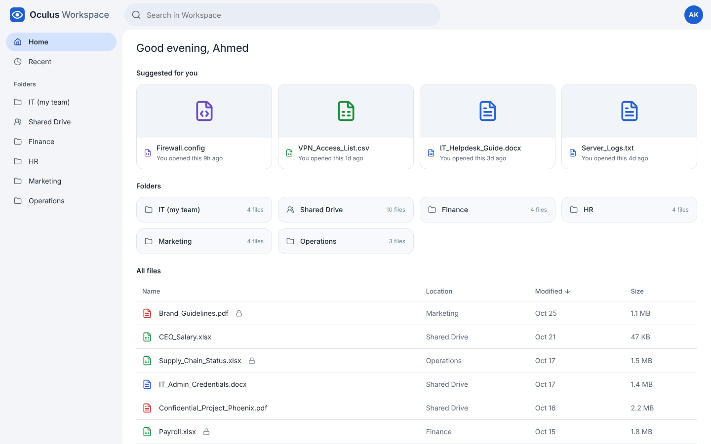
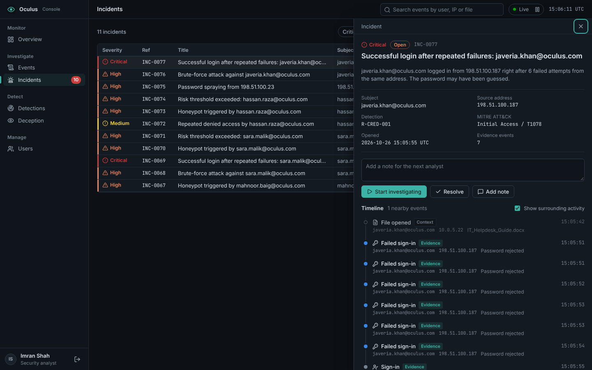
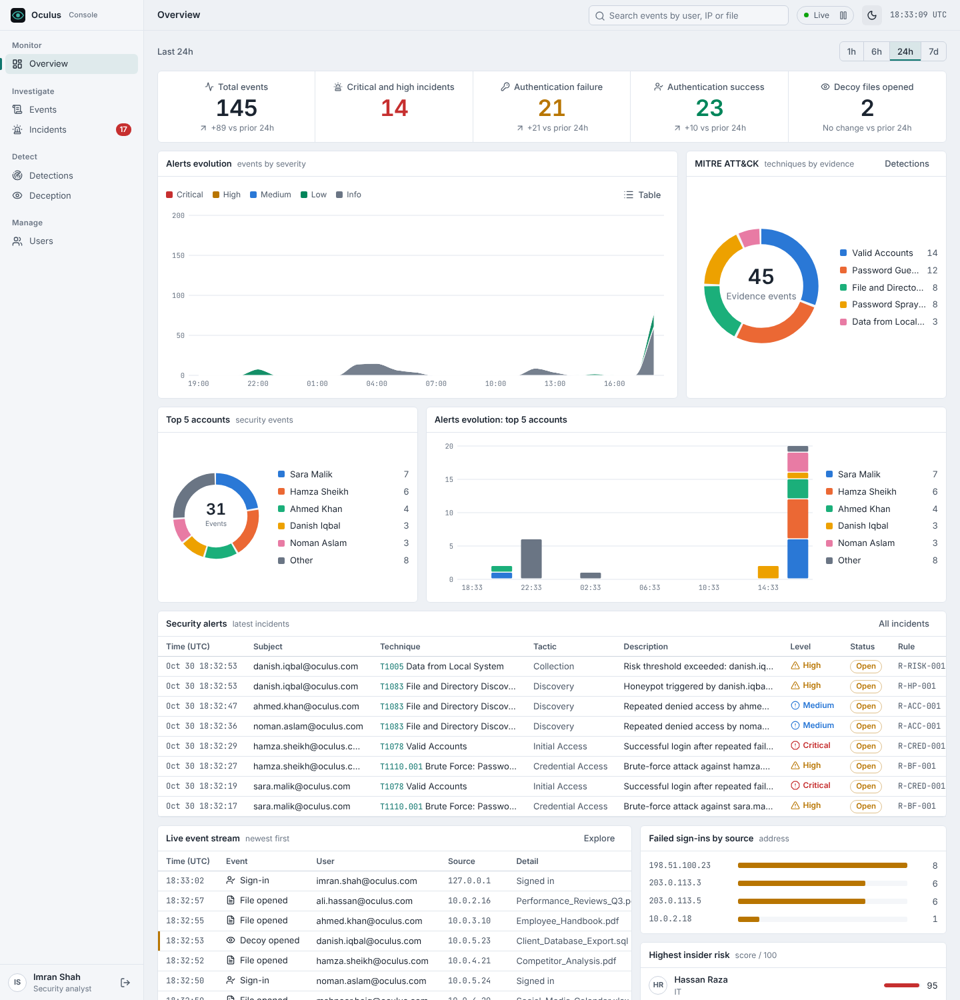

# Oculus: SIEM with honeypot-based insider-threat detection

[](https://github.com/YOUR-USERNAME/oculus-siem/actions/workflows/ci.yml)


<!-- Replace YOUR-USERNAME in the CI badge with your GitHub username. -->

Oculus collects security events (sign-ins, file access), scores insider-threat risk per employee, plants **decoy files**
that no legitimate user should ever open, correlates evidence into **incidents** mapped to MITRE ATT&CK, and gives analysts a
SOC-style console to investigate them. Employees get a calm, everyday file workspace and never see any of it.



## What it does

| Capability | How |
|---|---|
| **Detection engine** | 6 rules tagged with MITRE ATT&CK techniques, including a correlation rule (successful login after repeated failures from the same address). Deterministic: rules evaluate relative to the event, so live traffic and replayed history give the same result. |
| **Deception** | Decoy files sit in the Shared Drive, indistinguishable from real ones. They open normally and alert silently, so the person is never tipped off. |
| **Insider-risk scoring** | Points per violation, 0-100, with daily decay. Failed logins are deliberately *not* scored, otherwise an attacker could frame a colleague by typing wrong passwords. |
| **Incident workflow** | One open incident per attack (enforced by a database index, not application code), linked evidence, surrounding-activity timeline, analyst notes, Open, Investigating, Resolved. |
| **Brute-force protection** | Lockout per account and address, per-address block for password spraying, `429` with `Retry-After`. |
| **Live console** | Dashboard modelled on Wazuh/Splunk: KPI strip, alerts evolution, MITRE donut, top accounts, security alerts, live event stream. Dark and light themes. |
| **API** | JWT auth (httpOnly cookie + CSRF, or Bearer), OpenAPI 3.1 spec, Swagger UI at `/api/docs`, Postman collection. |

## Architecture



### What happens when an employee opens a decoy



## Detections

| ID | Rule | MITRE technique | Severity |
|---|---|---|---|
| R-BF-001 | Brute-force login attempts (5 failures, one account, one IP, 15 min) | T1110.001 Password Guessing | High |
| R-SPRAY-001 | Password spraying (5 distinct accounts failing from one IP) | T1110.003 Password Spraying | High |
| R-CRED-001 | Successful login after 3+ failures, same account and IP *(correlation)* | T1078 Valid Accounts | **Critical** |
| R-HP-001 | Decoy file accessed | T1083 File and Directory Discovery | High |
| R-ACC-001 | Repeated denied access (3 in 30 min) | T1083 File and Directory Discovery | Medium |
| R-RISK-001 | Insider-risk score above 70 | T1005 Data from Local System | High |

Thresholds live in configuration, not code. Details and design choices: [docs/DETECTIONS.md](docs/DETECTIONS.md).

## Security design

The original university version had no authentication at all. [docs/SECURITY_AUDIT.md](docs/SECURITY_AUDIT.md) records each
finding, how it was confirmed, the fix and the regression test.

| Threat | Control |
|---|---|
| Anonymous access, privilege escalation | JWT on every route, role checks from the verified token only (never from request input) |
| Session theft, CSRF | httpOnly + SameSite=Strict cookie, CSRF double-submit token, `alg` pinned to HS256 |
| XSS | No `innerHTML` in the app's own code (DOM builder), strict CSP (`script-src 'self'`, no inline scripts, self-hosted fonts and icons), server-side validation |
| Password guessing and spraying | Lockout and per-IP block, plus detection and incidents |
| Framing a colleague | Failed logins never raise the target's insider-risk score |
| Weak secrets | App refuses to start with the default `SECRET_KEY` outside development; bcrypt password hashes |
| Timestamps | All UTC (`timestamptz`); naive datetimes are rejected at the type level |

## Quick start (Windows PowerShell)

```powershell
# 1. Create the database once. In psql or pgAdmin as a superuser:
#      CREATE ROLE oculus_user LOGIN PASSWORD 'choose-a-password';
#      CREATE DATABASE oculus_pro OWNER oculus_user;
#    (PostgreSQL 15+ also needs:  GRANT ALL ON SCHEMA public TO oculus_user;  while connected to oculus_pro)

# 2. Python environment
python -m venv .venv
.venv\Scripts\Activate.ps1
pip install -r requirements.txt

# 3. Configuration
copy .env.example .env      # set DB_NAME, DB_PASSWORD and SECRET_KEY:
python -c "import secrets; print(secrets.token_hex(32))"

# 4. Schema and demo data (a company, a replayed week of activity, scripted attacks)
flask --app run db upgrade
flask --app run seed

# 5. Run
python run.py               # open http://localhost:5000
```

On the login page, **Try the demo** signs you in with one click (demo mode is on when `FLASK_ENV=development`;
never enable it in production). Accounts are fictional: analyst `imran.shah@oculus.com` / `Oculus#Admin26`,
employee `ahmed.khan@oculus.com` / `Oculus#Demo26`. Reset with `flask --app run seed --reset`.

### Live demo traffic

In a second terminal (venv active), stream normal activity plus an attack roughly every 40 seconds through the real
pipeline, and watch the Console's Overview move:

```powershell
flask --app run simulate                 # Ctrl+C to stop
flask --app run simulate --attacks 0     # normal traffic only
```

## Two interfaces

| | Oculus Workspace (employees) | Oculus Console (analysts) |
|---|---|---|
| Feels like | everyday cloud-drive office software | a SOC console (Splunk / Wazuh / Elastic style) |
| Theme | light | dark by default, light toggle |
| Never shows | risk scores, anything about monitoring | n/a |

| | |
|---|---|
|  |  |
|  |  |

Design notes and validated chart palettes: [docs/DESIGN.md](docs/DESIGN.md).

## API

Interactive reference at **`/api/docs`** (Swagger UI, self-hosted so the CSP stays strict), raw spec at `/api/openapi.json`.
A Postman collection and environment are in [`docs/postman/`](docs/postman/); they are generated from the spec
(`python scripts/make_postman.py`), so they cannot drift. To try it: `POST /api/login`, copy the `token`, press
**Authorize**.

## Tests and CI

```powershell
pip install -r requirements-dev.txt
pytest                      # in-memory SQLite, no setup needed
pytest --cov=app            # coverage
```

The suite (unit, integration, security regression, API contract tests that check real responses against the OpenAPI
schemas) also runs against PostgreSQL by setting `TEST_DATABASE_URL` to a *throwaway* database (it creates and drops
tables). GitHub Actions runs it on SQLite and PostgreSQL 16, applies the migrations to an empty database, checks that models
and migrations have not drifted, seeds the demo data, and verifies the Postman collection matches the spec.

## Project layout

```
app/
  __init__.py        application factory, security headers, static frontend
  config.py          settings (env-driven) and detection thresholds
  models.py          SQLAlchemy models, all timestamps UTC
  security.py        JWT, CSRF, @login_required / @admin_required
  openapi.py         the OpenAPI 3.1 document (contract-tested against every route)
  routes/            thin HTTP blueprints
  services/          ingest pipeline, detection rules, risk, incidents, lockout
  seed.py            demo data replayed through the real pipeline
  simulate.py        live traffic and attack simulator
frontend/            vanilla JS ES modules, no build step; Console and Workspace
migrations/          Alembic migrations
docs/                architecture, detections, database, design, security audit, Postman, screenshots
tests/               pytest suite
scripts/             make_postman.py
```

## Limitations and roadmap

* Live updates use 3-second polling. WebSockets or SSE would be the next step at larger scale.
* Detection rules are code. A rule editor and tuning UI would be a natural extension.
* Lockout counters are database-backed per account and address. Behind a reverse proxy, configure trusted proxy headers
  before relying on source-IP data.
* No MFA or SSO. TLS termination is expected at a reverse proxy; set `COOKIE_SECURE=true` once serving over HTTPS.
* Single-node demo scale. The schema is indexed for the dashboard queries, but it has not been load-tested.

## Origin

Oculus started as a university course project (Software Project Management). This repository is my own redesign and rebuild
of it: the security audit and fixes, the PostgreSQL schema and migrations, the detection and correlation engine, the Console
and Workspace interfaces, the API documentation, and the test and CI setup. I designed it with AI assistance (Claude) and
reviewed and tested the result myself.

## License

MIT. See [LICENSE](LICENSE).
