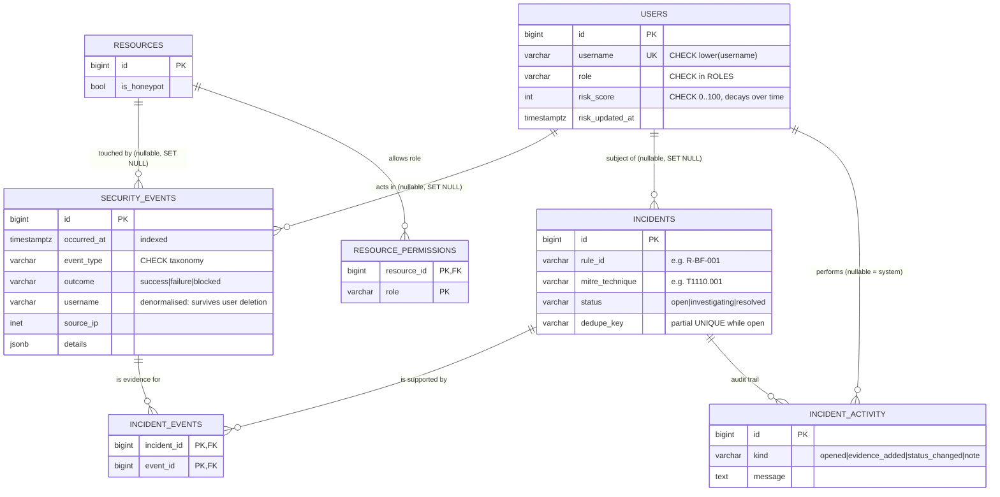

# Database design

PostgreSQL 16 is the production target. Schema changes go through **Alembic migrations** (`migrations/`); the demo
company is generated by `flask seed`, which replays history through the real detection pipeline.

## Decisions worth knowing

| Decision | Why |
|---|---|
| `timestamptz`, and naive datetimes are **rejected** in Python (`UTCDateTime`) | The classic SIEM bug is events displaying hours off because of a time zone mix-up. Making it an error instead of a convention removes the bug class. |
| `inet` for addresses, `jsonb` for event details | Native types validate input, support subnet operators and (for jsonb) indexing. SQLite fallbacks exist only so the test suite needs no server. |
| Incidents **link** to events (`incident_events`) instead of copying them | One piece of evidence can support several incidents, and the timeline is a join, not a re-parse of text. |
| Partial unique index `uq_incidents_open_dedupe` | At most one *open* incident per (rule, subject). The database enforces it, so two concurrent requests cannot create duplicates; the app handles the conflict with a SAVEPOINT. |
| `ON DELETE SET NULL` + denormalised `username` on events | Deleting an employee must not destroy the audit trail. Foreign keys are enforced in the SQLite test database too (`PRAGMA foreign_keys=ON`). |
| `CHECK` constraints instead of native enums | Adding a role or event type is a one-line migration instead of `ALTER TYPE` gymnastics. |
| Lazy risk decay (`effective_score`) | No background job; decay is computed from `risk_updated_at` on read and materialised on write. |
| Naming convention for constraints | Alembic can drop and alter constraints deterministically. |
| Hand-reviewed migrations with no imports from app code | Old migrations must keep working after the app is refactored. |

## Verified

`flask db upgrade` → `flask db check` ("No new upgrade operations detected") → `flask db downgrade base` → `upgrade` all run clean on PostgreSQL 16.

## Known limitations / next steps
* `evidenceCount` loads the link rows; at scale this should become a `COUNT` subquery.
* `security_events` is a plain table; at millions of rows, partition by month on `occurred_at`.
* Related incidents from one attack chain (e.g. brute force → compromise → honeypot) are separate rows; grouping them into a "case" is a planned enhancement.
